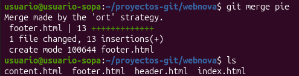
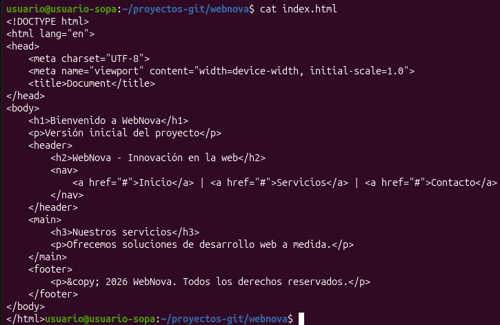
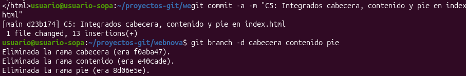
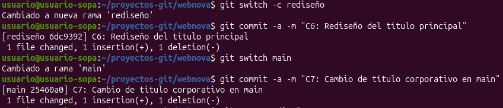
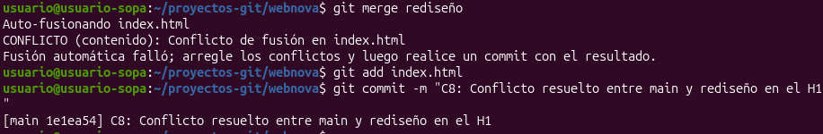
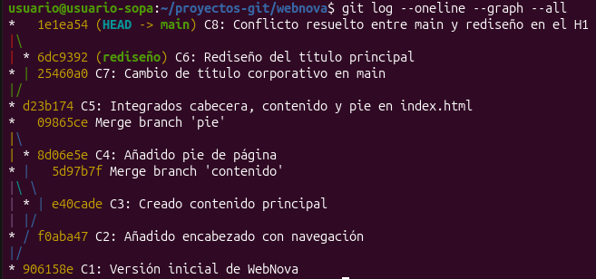

# Practica 4

## Preparación
Para empezar, creamos un nuevo repositorio vacío para nuestra practica

  

Además de crear un archivo nuevo HTML y añadirle un par de líneas básicas

  

## Desarrollo
Creamos las ramas necesarias y comprobamos que, efectivamente, se han creado

  

  

A continuación voy a trabajar en cada rama creada añadiendo un archivo HTML a cada una y haciéndole un commit a los archivos creados para guardarlos
 

Rama cabecera:  

  

Rama contenido:  

  

Rama pie:  

  

Ahora vamos a combinar todas las ramas en la rama main con el comando "merge" (solo se ve un merge hecho porque no hice captura pero se ve que están todos los archivos)  

  

Luego unificamos el código de todas las ramas en el index

  

Guardamos los cambios y borramos las ramas anteriores porque ya no nos hacen falta

  

## Simulación de conflicto
Creamos un nueva rama donde modificamos la etiqueta "h1" del archivo index

  

Después juntamos la rama rediseño a la rama main y vemos que nos sale un error de conflicto al intentar añadir un "h1" cuando la página original de la rama main ya tenía uno, modificamos el archivo y guardamos

  

## Git log final
Aquí vemos todos los git logs hechos de forma más comoda en modo de gráfico

  
