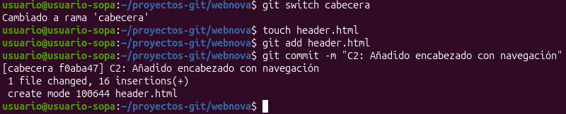
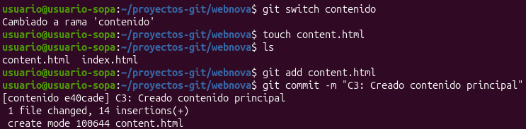
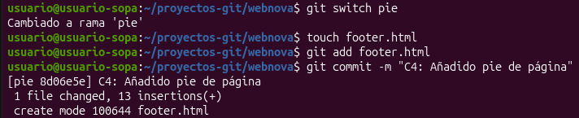

# Practica 4

## Preparación
Para empezar, creamos un nuevo repositorio vacío para nuestra practica

  

Además de crear un archivo nuevo HTML y añadirle un par de líneas básicas

  

## Desarrollo
Creamos las ramas necesarias y comprobamos que, efectivamente, se han creado

  

  

A continuación voy a trabajar en cada rama creada añadiendo un archivo HTML a cada una y haciéndole un commit a los archivos creados para guardarlos
  

Rama cabecera:  

  

Rama contenido:  

  

Rama pie:  

  
