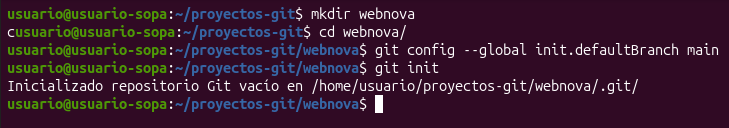
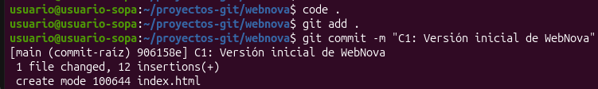
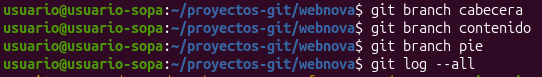
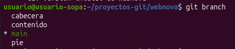

# Practica 4

## Preparación
Para empezar, creamos un nuevo repositorio vacío para nuestra practica

  

Además de crear un archivo nuevo HTML y añadirle un par de líneas básicas

  

## Desarrollo
Creamos las ramas necesarias y comprobamos que, efectivamente, se han creado

 

  
